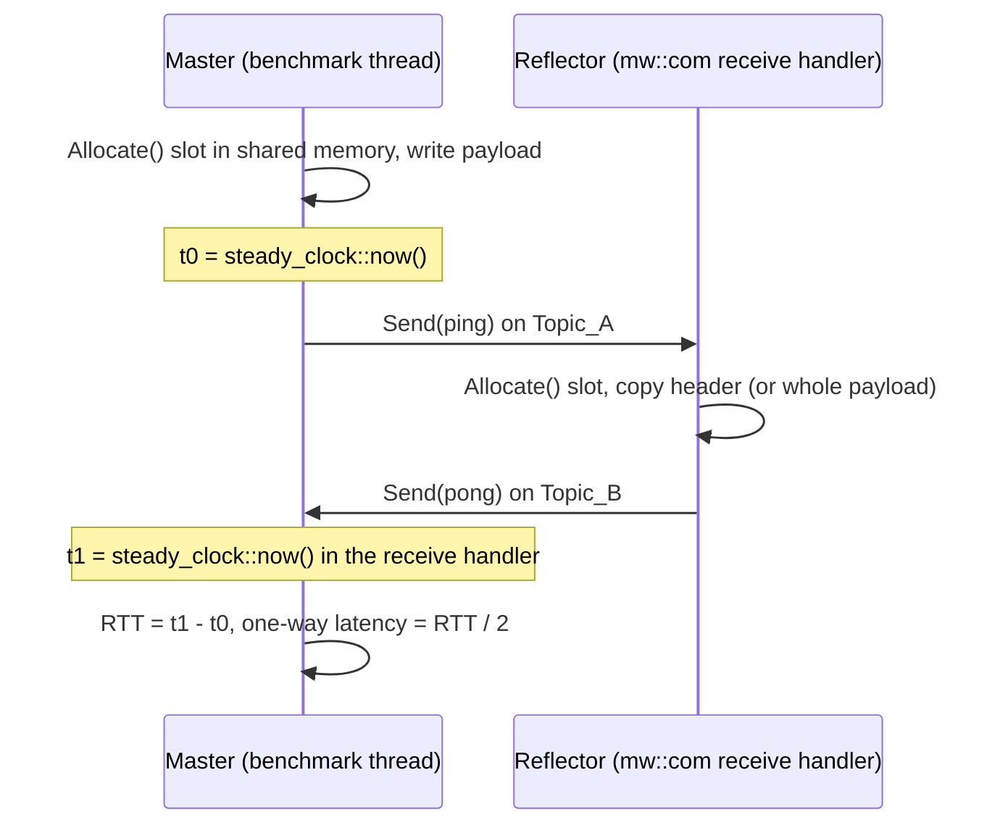

# score::mw::com ping-pong benchmark

[](https://github.com/intilinux-eng/scrample-pingpong-bench/actions/workflows/build.yml)

A latency, jitter and throughput benchmark for `score::mw::com`, the zero-copy IPC middleware of
[Eclipse S-CORE](https://github.com/eclipse-score), plus the notes I wrote while building it.

The question it answers: **does the cost of sending a message stay constant when the payload grows
from 64 bytes to 10 MiB?** A copying transport gets slower in proportion to the payload. A zero-copy
transport hands over a reference to shared memory, so it should not.

The repository is two things in one VS Code project:

- a runnable benchmark (`src/benchmark/`), built with Bazel and Google Benchmark;
- a knowledge base (`docs/`) on zero-copy IPC, the `mw::com` API and Linux real-time tuning.

## How it works



Three benchmarks run over the payload sizes 64 B, 512 B, 4 KiB, 32 KiB, 256 KiB, 2 MiB and 10 MiB:

| Benchmark | Payload written | Timed region | Reflector echoes | Expected |
|---|---|---|---|---|
| `BM_PingPong_NoFill` | no | `Send(ping)` until the pong arrives | header only | flat, O(1) |
| `BM_PingPong` | yes, before the timed region | `Send(ping)` until the pong arrives | header only | flat until the payload outgrows the CPU caches |
| `BM_PingPong_FullEcho` | yes, inside the timed region | allocate, fill, send, until the pong arrives | all N bytes (`memcpy`) | linear, O(N) |

The first isolates the middleware. The second shows the same transfer right after an application
produced the data. The third adds the application's own memory work to the timed region. Side by
side, the three curves show where the time goes.
[docs/03-benchmark-design.md](docs/03-benchmark-design.md) explains why one benchmark cannot do it all.

In the CI smoke test (a shared 2-vCPU runner, so the shape counts, not the values) the mean round
trip from 64 B to 10 MiB was 14.7 to 16.5 µs for `BM_PingPong_NoFill`, with a fitted complexity of
O(1), and grew from 15.5 µs to 1156 µs for `BM_PingPong_FullEcho`.

## Quick start

Everything builds and runs on **Linux x86-64** only. On Windows, open the folder in WSL 2 or in the
dev container; both are functional environments, not real-time ones (see
[Status and limits](#status-and-limits)).

**Step 1 (preferred: WSL 2 (Ubuntu).** Clone inside the Linux file system, not under `/mnt/c`.

```bash
sudo apt update && sudo apt install -y build-essential git util-linux
sudo curl -fsSL -o /usr/local/bin/bazel \
  https://github.com/bazelbuild/bazelisk/releases/latest/download/bazelisk-linux-amd64
sudo chmod +x /usr/local/bin/bazel

git clone https://github.com/intilinux-eng/scrample-pingpong-bench.git
cd scrample-pingpong-bench && code .
```

**Step 2: dev container.** With Docker and the *Dev Containers* extension installed, run
*Dev Containers: Reopen in Container*. The image is the one eclipse-score/scrample uses.

Then, in VS Code, *Terminal > Run Task...* offers the tasks below. The same commands work in a shell.

| Task | Command |
|---|---|
| bazel: build (opt) | `bazel build --config=host -c opt //src/benchmark:score_pingpong_bench` |
| bench: quick run | `bazel run --config=host -c opt //src/benchmark:score_pingpong_bench -- --service_instance_manifest=$PWD/src/benchmark/etc/mw_com_config.json` |
| bench: real-time run (single process) | `src/benchmark/run_benchmark.sh` |
| bench: real-time run (two processes) | `BENCH_MODE=split src/benchmark/run_benchmark.sh` |

`--config=host` is mandatory: it carries the feature flags the S-CORE modules need.

`run_benchmark.sh` builds with `-c opt`, then starts the binary through
`sudo taskset -c 2,3 chrt -f 99`. Its settings are environment variables:

| Variable | Default | Meaning |
|---|---|---|
| `BENCH_CORES` | `2,3` | CPU for the Master, CPU for the Reflector |
| `BENCH_RT_PRIO` | `99` | `SCHED_FIFO` priority |
| `BENCH_MODE` | `single` | `single` = one process, `split` = Master and Reflector as two processes |
| `BENCH_FORMAT` | `json` | `json` or `csv` |
| `BENCH_OUT` | `benchmark_results/pingpong_<timestamp>.<format>` | result file |
| `BENCH_REPS` | `5` | `--benchmark_repetitions` |

Extra arguments are passed on to Google Benchmark, for example
`src/benchmark/run_benchmark.sh --benchmark_filter='BM_PingPong/'`.

## Reading the output

Each row is one payload size. `Time` is the mean round-trip time. The `_BigO` row is the complexity
Google Benchmark fitted across the sizes, and `_RMS` is how well that curve fits. `(1)` with a small
RMS for `BM_PingPong_NoFill` is the result the benchmark is looking for. Trust the fit only when the
RMS is low; otherwise read the `Time` column.

| Counter | Meaning |
|---|---|
| `oneway_min_ns` … `oneway_max_ns` | one-way latency (RTT / 2): min, mean, p50, p99, p99.9, max |
| `jitter_stddev_ns` | standard deviation of the one-way latency |
| `jitter_peak_to_peak_ns` | max minus min of the one-way latency |
| `items_per_second` | round trips per second, from the summed round-trip time |
| `bytes_per_second` | payload bytes per second carried by the pings |
| `wall_round_trips_per_sec` | round trips per second by wall clock, including the payload fill |
| `payload_bytes` | bytes of the slot used in this run |

Throughput is **closed-loop**: one message is in flight at a time, so the rate is 1 / RTT. It is not
the maximum streaming rate of the middleware.

## Repository layout

```text
src/benchmark/
  pingpong_bench.cpp        payload, service interfaces, Master, Reflector, benchmarks, main
  BUILD.bazel               the score_pingpong_bench target
  etc/mw_com_config.json    mw::com manifest: Topic_A and Topic_B on the shared-memory binding
  run_benchmark.sh          opt build + pinned SCHED_FIFO run
docs/                       knowledge base (see below)
MODULE.bazel, .bazelrc      S-CORE dependencies and flags, mirrored from eclipse-score/scrample
.vscode/, .devcontainer/    tasks, debug configuration, IntelliSense paths, container
.github/workflows/build.yml build and smoke test on every push
```

## Knowledge base

| Note | What it covers |
|---|---|
| [01 Zero-copy IPC](docs/01-zero-copy-ipc.md) | why a zero-copy transfer is O(1), what stays O(N), how `mw::com` does it |
| [02 mw::com API cheat sheet](docs/02-mw-com-api-cheatsheet.md) | the calls the benchmark uses, next to their `ara::com` counterparts |
| [03 Benchmark design](docs/03-benchmark-design.md) | each measurement decision, and the mistake it avoids |
| [04 Linux real-time tuning](docs/04-linux-realtime-tuning.md) | core isolation, `SCHED_FIFO`, memory locking, and how to check each |
| [Results log](docs/results-log.md) | where measured runs get recorded, with the context needed to trust them |

To add a topic, create `docs/NN-topic.md` and add a row here. A note is worth keeping when it records
something that took effort to find out: a decision and its reason, a pitfall, a verified API detail.

## Using it inside a scrample fork

`src/benchmark/` is self-contained. Copy it into a fork of
[eclipse-score/scrample](https://github.com/eclipse-score/scrample) and add one line to that
repository's `MODULE.bazel`:

```starlark
bazel_dep(name = "google_benchmark", version = "1.9.5", repo_name = "com_github_google_benchmark")
```

## Status and limits

- **Build and smoke test:** see the badge above. CI builds the binary and runs both topologies
  briefly on a shared runner.
- **Real-time measurements:** none recorded yet. Numbers from CI, WSL 2, a container or a VM show
  that the benchmark works, not how fast `mw::com` is. Results that count need a bare-metal Linux
  machine set up as in [docs/04](docs/04-linux-realtime-tuning.md), and belong in the
  [results log](docs/results-log.md).
- **Versions:** written against `score_communication` 0.1.1 and `score_baselibs` 0.1.3, the versions
  scrample pins. The `mw::com` API changes between releases.
- **Memory:** about 100 MiB of `/dev/shm` (5 slots × 10 MiB × 2 topics).
- **Shutdown message:** in two-process mode the Reflector can log
  `Sending UnregisterEventNotificationMessage ... failed` when the Master has already exited. It is
  harmless.

## License

Apache-2.0, see [LICENSE](LICENSE). The benchmark follows the structure of the S-CORE sample
application [scrample](https://github.com/eclipse-score/scrample), which is also Apache-2.0.
